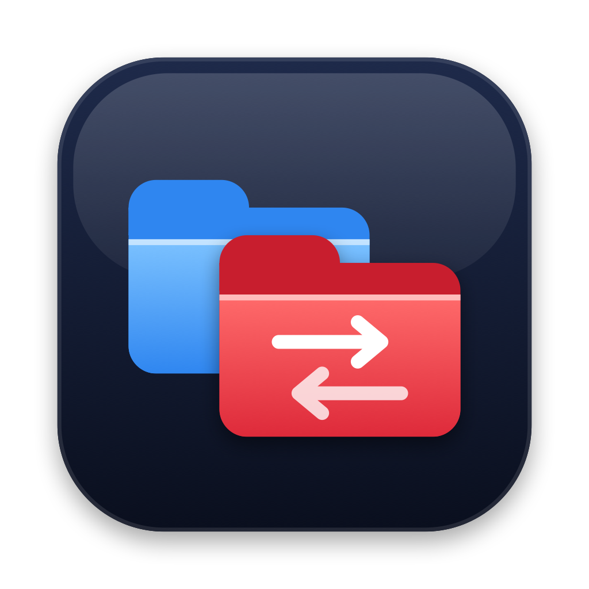

<a href="https://github.com/ranczandras/CZ.commander/releases/latest/download/CZ.commander.zip"></a>

# CZ.commander

### [⬇ Download CZ.commander for macOS](https://github.com/ranczandras/CZ.commander/releases/latest/download/CZ.commander.zip)

Click the icon or the link above (or [`CZ.commander.zip`](CZ.commander.zip) in the file list), unzip, move **CZ.commander.app** to `/Applications`. First launch: **System Settings → Privacy & Security → Open Anyway**.

A native macOS dual-pane file manager for Apple Silicon, inspired by the classic Total Commander workflow: two panels, folder tabs, function-key operations and a toolbox of power tools. Built with SwiftUI + AppKit, no third-party dependencies.

> CZ.commander is an independent project and is not affiliated with or endorsed by Ghisler Software GmbH, the maker of Total Commander.

---

## Download

Unzip it and move **CZ.commander.app** to `/Applications`. (The green **Code → Download ZIP** button on GitHub gives you the source code, not the app.) The app is not notarized by Apple, so the first launch is blocked; open it once, then choose **System Settings → Privacy & Security → Open Anyway**.

CZ.commander checks GitHub for a newer release at every launch and every 6 hours (can be turned off in Settings) and offers **Install & Restart**: it downloads the update, verifies it is signed by the same certificate, replaces the app and relaunches. **CZ.commander → Check for Updates…** checks right away.

Requires macOS 14 or later on Apple Silicon.

## Build & run

Requirements: macOS 14+, Apple Silicon, Xcode command line tools (Swift 6 toolchain).

```bash
./build_app.sh
open /Applications/CZ.commander.app
```

`build_app.sh` mirrors the sources to a local build cache (`~/.cache/czcommander-build`, override with `CZ_BUILD_DIR`), builds a release `arm64` binary, renders the app icon, assembles and signs the bundle on the local disk, then installs it to `/Applications` and copies it into the project folder.

Run the tests:

```bash
swift test --scratch-path ~/.cache/czcommander-build --disable-sandbox
```

### Code signing and macOS privacy prompts

If a code-signing identity named `CZ.commander Local Signing` exists in your keychain (override with `CZ_SIGN_ID`), the build signs with it; otherwise it falls back to ad-hoc signing. A stable identity keeps macOS privacy grants (removable volumes, Full Disk Access) across rebuilds. With ad-hoc signing every build looks like a new app to macOS, so the prompts come back.

A self-signed code-signing certificate is enough:

```bash
openssl req -x509 -newkey rsa:2048 -nodes -keyout key.pem -out cert.pem -days 3650 \
  -subj "/CN=CZ.commander Local Signing" \
  -addext "keyUsage=critical,digitalSignature" -addext "extendedKeyUsage=critical,codeSigning"
openssl pkcs12 -export -inkey key.pem -in cert.pem -name "CZ.commander Local Signing" -out id.p12
security import id.p12 -k ~/Library/Keychains/login.keychain-db -T /usr/bin/codesign
```

### Window snapshots (development)

```bash
CZ_SNAPSHOT_DIR=/tmp CZ_SNAPSHOT_WIDTHS=1040,1500 /Applications/CZ.commander.app/Contents/MacOS/CZCommander
```

Resizes the main window to each width, saves `snapshot_<width>.png` and quits.

### Releasing

```bash
./release.sh 1.1.0 "What changed"
```

Bumps `VERSION`, builds and signs the app, tags `v1.1.0`, pushes, creates the GitHub release with `CZ.commander.zip` and deletes older releases. The locally installed app is left alone so it can update itself.

### Settings

Settings and tabs are stored in `~/Library/Application Support/CZ.commander/config.json`.

---

## Features

### Panels, tabs and views
- Left and right panels, vertical or horizontal split; `Tab` switches panels, `Cmd+U` swaps them, `Opt+E` makes target = source.
- Square-cornered window with its own title bar; the active panel is marked by its header colour.
- Folder tabs per panel (`Cmd+T` new, `Cmd+Shift+T` duplicate, `Cmd+W` close, `Ctrl+Tab` switch), Total Commander style locking:
  - **Locked (`*`)**: changing directory opens a new tab.
  - **Locked, but directory changes allowed (`!`)**: navigate freely; selecting the tab again jumps back to the locked folder.
  - Tab menu: rename, duplicate, open in other panel, relock to current folder, close other / unlocked / duplicate tabs.
- Drive bar with every mounted volume and free space, plus quick folders (`~`, Desktop, Downloads, Documents, Applications, `/`, Trash). Adapts to the panel width.
- Sizes are always shown in the largest sensible unit (B, KB, MB, GB, TB).
- **Thumbnails** show real previews generated in the background: QuickLook for images, video, PDF and documents, and the first frame of **Blackmagic RAW (.braw)** clips. BRAW decoding uses the Blackmagic RAW decoder already installed with Blackmagic RAW Player or DaVinci Resolve (free from Blackmagic Design); without it .braw files show an icon.
- Two view modes: **Full** (name, extension, size, date) and **Thumbnails**; the **View** toolbar button switches between them.
- **Hidden** toolbar button (`Cmd+H`) shows or hides hidden files; it turns orange while hidden files are shown.
- Built for speed: no animations; cursor moves and selection update the list directly without re-rendering the rest of the window (well under 1 ms per step).
- Directory hotlist and history, Quick View (`Cmd+Y`).

### Mouse and keyboard
- Total Commander's Ctrl shortcuts use Cmd (Ctrl still works): `Cmd+M` Multi-Rename, `Cmd+T` / `Cmd+W` tabs, `Cmd+U` swap panels, `Cmd+H` hidden files, `Cmd+S` quick filter, `Cmd+A` select all, `Cmd+F3`…`Cmd+F6` sort. macOS keeps `Cmd+Q` (quit), `Cmd+F` (find), `Cmd+Tab` and `Cmd+Space`, so Quick View is `Cmd+Y`, FTP is `Cmd+Shift+F`, tab switching stays `Ctrl+Tab`.
- Every dialog opens inside the window with square corners; all controls are square.
- Right mouse button selects, like Total Commander: a short right click toggles the item, holding the button (~0.45 s) opens the context menu, right-dragging selects or deselects a range. Works in the list and in Thumbnails.
- Slow double click (a second click on the focused item) renames it in place, directly on the file name; `Shift+F6` does the same. Enter saves, Esc cancels.
- `Enter` opens folders, files and archives (`.zip`, `.tar`, `.tar.gz`, `.tar.bz2`, `.tar.xz`, `.7z`, `.iso`) as virtual folders; `Backspace` goes up and keeps the cursor on the folder you came from.
- `Space` selects and calculates folder sizes, `Alt+Shift+Enter` sizes every folder, `Insert` selects and moves down, `+` / `-` select / deselect by mask, `*` inverts, `/` restores the previous selection, `Shift+F2` compares directories.
- While the app is active it asks macOS for standard F1–F12 keys. Keyboards that handle Fn themselves (for example Logitech MX Keys) need their own Fn lock (`Fn+Esc`) or Logi Options+ settings.

### Function keys
- `F3` Lister: text (several encodings), binary, hex with search, and image / PDF viewer.
- `F4` internal editor (`Shift+F4` creates a new file).
- `F5` copy, `F6` move: target masks (`*.bak`), overwrite rules, CRC32 verification, background queue.
- `F7` new folder: several at once (`a|b|c`), nested paths, date / time templates.
- `F8` delete to Trash with a confirmation dialog; `Shift+F8` deletes permanently.

### Power tools
- **Multi-Rename** (`Cmd+M`): `[N]`, `[N1-5]`, `[E]`, `[C]`, `[YMD]`, `[hms]` masks, search & replace (incl. regex), case conversion, counters, live preview with conflict check, undo, presets.
- **Find Files** (`Alt+F7`): wildcard / regex names, text in files, date / size / attribute filters, duplicate finder (name, size, SHA-256), feed results to the panel.
- **Synchronize Directories**, **Compare by Content** (side-by-side text diff and binary hex diff).
- **Archives**: create and extract `.zip` / `.tar` variants, browse archives inside the panel.
- **Split & Combine** with `.crc` files, **checksums** (CRC32 `.sfv`, MD5, SHA-1, SHA-256, SHA-512), **encode / decode** (Base64, UUEncode, XXEncode).
- **Attributes**: POSIX permissions, macOS locked / hidden flags, Finder tags, timestamps.
- **Cleanup** (toolbar button, `Cmd+Opt+K`): scans the Trash, application and browser caches, logs, old temporary files, Xcode and developer-tool caches and large leftovers (device backups, installers in Downloads), groups them by category and deletes only what you tick. Regenerable data is ticked by default; anything that costs a long re-download or is not regenerated is marked "review first". What is scanned and what is never touched is documented in [docs/CLEANUP.md](docs/CLEANUP.md).
- **Empty Trash** (toolbar button, `Cmd+Shift+Backspace`): shows how much is in the Trash (home and other drives) and deletes it after confirmation.
- **YouTube Downloader** (toolbar button, `Cmd+Opt+Y`): paste one or more video, playlist or channel links and download them as **MP4** (best resolution, video + audio merged) or **MP3** (best audio, VBR, cover art). Optional **YouTube login** taken from Safari, Chrome, Firefox, Brave, Edge, Vivaldi, Opera or Chromium (no password asked): passes the "confirm you're not a bot" check, opens private / age-restricted videos and Watch Later / Liked lists, and gets YouTube Premium quality (1080p Premium, 256 kbps audio) when the account has it. Files go to `~/Downloads/YoutubeZ`, playlists into their own numbered folder; downloads keep running when the window is closed. Uses [yt-dlp](https://github.com/yt-dlp/yt-dlp), ffmpeg and a JavaScript runtime: existing Homebrew installs are used, otherwise the official builds are downloaded once into `~/Library/Application Support/CZ.commander/tools` and verified with SHA-256.
- Properties & hash inspector, file list export (TXT, CSV, MD, HTML), disk space analyzer, FTP / SFTP connection manager.

## License

MIT, see [LICENSE](LICENSE). `Sources/BRAWBridge/BlackmagicSDK` contains the Blackmagic RAW API header and loader from the Blackmagic RAW SDK under Blackmagic Design's permissive license (see the file headers).
